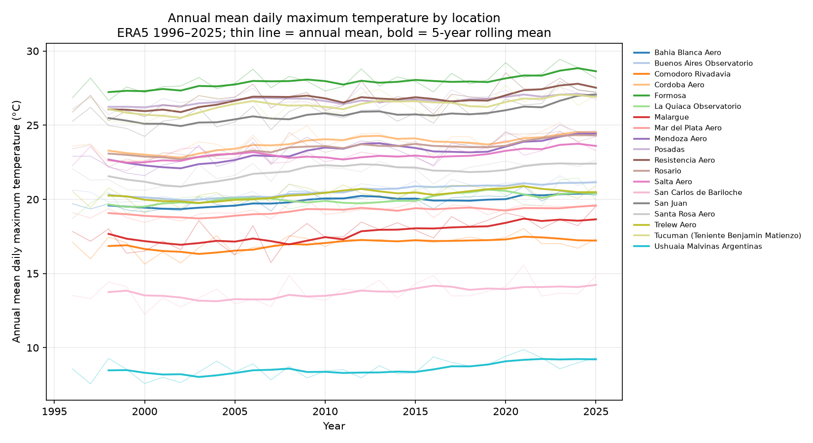
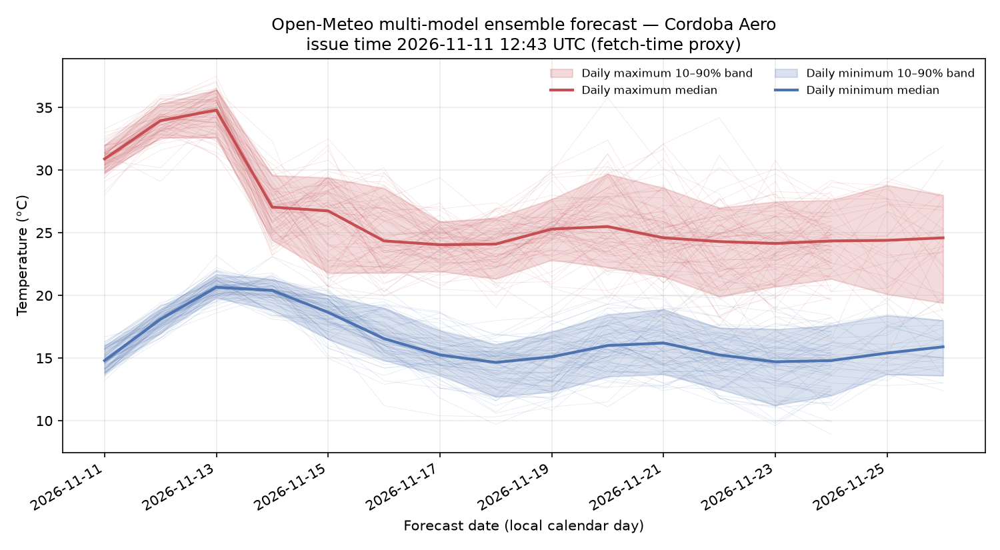
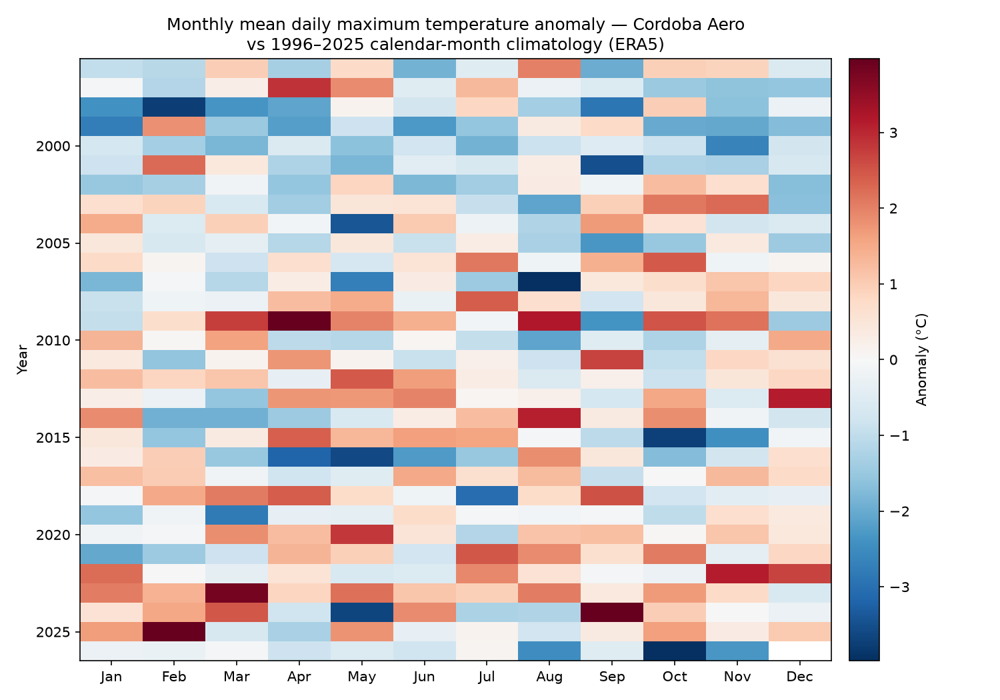

# PRISMA

**Starting with Argentina, designed to scale globally.**

PRISMA is an open, cross-platform project that cross-references real-time weather and climate data, verifies forecasts against observations, and will show calibrated probabilities instead of single numbers.

## Status

Early-stage independent research. Be precise about what exists today:

**Works today:**

- Ingest of Open-Meteo (ERA5 history + multi-model ensemble forecast), NOAA GHCN-Daily station observations, NOAA ONI/SAM indices, and SMN Argentina daily min/max temperature into normalized Parquet.
- A quality-control pass (physical limits, spikes, duplicate rows) and a source registry with licenses in [`configs/sources.yaml`](configs/sources.yaml).
- Notebook 01 generating real figures for 19 stations across Argentina's climate zones.
- A source-discrepancy report (ERA5 vs GHCN-Daily per station and day, with bias/correlation flags) written to `results/discrepancies/` by script, plus an SMN leg comparing the gitignored regtemp capture against both sources — with overlapping days **only on the ERA5 side** (2025-11-11 → 2026-11-05); the SMN-vs-GHCN comparison has **zero overlapping days** (GHCN-Daily ok rows end 2025-08-24, the regtemp capture starts 2025-11-11) and therefore produces no rows (same flag scheme; gaps reported, never filled). The 2026-11-13 correction in that report shows the ERA5 cold divergence is **leg-dependent** — −2.91 °C against GHCN vs −0.97 °C against SMN on `t2m_max`, over 0 shared days — and the cause is **not established**.
- An SMN observation archive workflow ([`.github/workflows/observations.yml`](.github/workflows/observations.yml)) that captures the open-data payloads exactly as served into Hugging Face; its first run succeeded on 2026-11-13 ([run 43484816198](https://github.com/Akunimal/prisma-climate/actions/runs/43484816198)), so `observations/smn/{datohorario,observaciones,regtemp}/2026-11-12/` is archived.
- A GitHub Actions workflow that archives the ensemble forecast on a daily schedule (past member values are retained by the provider for about 3 days, but the past run's issue-dated lead structure is not reconstructible — a 2026-11-13 probe showed `past_days` returns the current run's future segment unchanged and past-day cells that do not match the archived issue-dated forecasts, with no run/cycle id in the payload — so a missed day **cannot** be repaired into verification data and is lost; no deep uniform-cycle ensemble backfill exists). The archive mechanism and the schedule trigger are both proven — see [Daily forecast archive](#daily-forecast-archive).
- Verification metrics (`backend/src/prisma/verify/metrics.py`) implemented as code and tests; no numbers published until the 15-issue-date gate in [`docs/EVALUATION_PROTOCOL.md`](docs/EVALUATION_PROTOCOL.md).

**Does not exist yet:** calibration, the API, the Flutter app, and SMN precipitation (no field in the open-data payloads; see [`docs/DATA_SOURCES.md`](docs/DATA_SOURCES.md)). Nothing in `results/` was produced by anything other than a script in this repository.

## Quickstart

Requires [uv](https://docs.astral.sh/uv/). From the repository root:

```bash
uv sync --project backend
uv run --project backend python -m prisma.ingest
uv run --project backend python scripts/run_notebook.py
```

The third command writes the figures below to `results/figures/`. Run `uv run --project backend pytest` to check the test suite.

## Figures

Annual mean daily maximum temperature per location, ERA5 1996–2025 (5-year rolling mean in bold):



Current ensemble forecast with the 10–90% band for Córdoba:



Monthly temperature-maximum anomaly for Córdoba against its 1996–2025 calendar-month climatology:



All three figures are regenerated by `scripts/run_notebook.py` from the Parquet files under `data/raw/` (downloaded, gitignored).

## Data sources

Every source is registered in [`configs/sources.yaml`](configs/sources.yaml) and described in [`docs/DATA_SOURCES.md`](docs/DATA_SOURCES.md) with license, update frequency, redistribution rights, and day convention. Summary:

| Source | License | Redistributable | Status |
|---|---|---|---|
| Open-Meteo (ERA5 + ensemble) | CC BY 4.0 (free tier non-commercial); ERA5 under Copernicus licence | Derived only | active |
| NOAA GHCN-Daily | Public domain (NOAA/NCEI) | Yes | active, but **stale at source**: last valid rows 2025-08-24 (~50% daily coverage since 2005) |
| NOAA ONI / SAM indices | Public domain (NOAA/NWS) | Yes | active |
| SMN Argentina | CC BY 2.5 AR (PAD_legales.pdf, Infoleg disp25.pdf) | Yes | active — **current station reference for temperature** |

## Daily forecast archive

The workflow [`.github/workflows/ingest.yml`](.github/workflows/ingest.yml) is scheduled for **06:47, 09:47, 12:17, 14:43 and 18:31 UTC** on `ubuntu-latest`, fetches the Open-Meteo ensemble for all configured locations with its `issue_time`, and stores the Parquet outside git:

1. **Primary — Hugging Face dataset [`Akunimal/prisma-climate`](https://huggingface.co/datasets/Akunimal/prisma-climate):** one file per issue date at `forecasts/<issue_date>/openmeteo-ensemble_<issue_date>.parquet` (secret `HF_TOKEN`, variable `HF_DATASET_REPO`). The issue date is read from the parquet's `issue_time`, never from the runner clock; an existing target is skipped, so the first archive of an issue date is canonical and frozen.
2. **Fallback / provenance — GitHub Release `forecast-YYYY-MM-DD`:** used when `HF_TOKEN`/`HF_DATASET_REPO` are unconfigured **or** the Hugging Face upload step fails, so a transient HF error never loses a day. Releases are kept afterwards (for example [`forecast-2026-11-11`](https://github.com/Akunimal/prisma-climate/releases/tag/forecast-2026-11-11)).

**Schedule forensics lives in [`docs/OPERATIONS.md`](docs/OPERATIONS.md):** observed run history (the first `event=schedule` run completed 2026-11-12, hours late; the 2026-11-12 issue date was rescued by a manual `workflow_dispatch`), the slot-to-run readings, and the residual-risk note on GitHub's best-effort schedule.

Schema, licences, attribution, provenance and the 15-issue-date evaluation gate are documented in [`docs/HF_DATASET_CARD.md`](docs/HF_DATASET_CARD.md), mirrored to the dataset's `README.md` (the mirror is republished by hand or by dispatching `hf-backfill.yml` — mirroring the card regenerated on 2026-11-13 is a **pending owner action**). The gate counts distinct issue dates regardless of trigger; the manual rescue is recorded in the card and in [`docs/DATA_SOURCES.md`](docs/DATA_SOURCES.md) so it stays visible.

## Observation archive (SMN)

[`.github/workflows/observations.yml`](.github/workflows/observations.yml) captures the SMN Argentina open-data payloads exactly as served into the same dataset under `observations/smn/<dato>/<date>/`: `datohorario` and `observaciones` daily at 07:17, 11:41 and 19:09 UTC, `regtemp` weekly on Mondays at 04:34 UTC, `workflow_dispatch` enabled. It is isolated from `ingest.yml` (own schedule, own concurrency group, `contents: read`, no push step, so it never commits to `main` — its run status travels in the `github_run` block of the manifest it writes, and an SMN failure fails only this workflow). The date key comes from the payload's `FECHA` and never from the runner clock (`regtemp` uses the last `FECHA` of its rolling 365-day window), an existing target is skipped so the first capture of a date is canonical, and because these endpoints ignore `fecha` (probed 2026-11-13) a missed day cannot be backfilled; the payloads are CC BY 2.5 AR with attribution to the SMN, distinct from the dataset-level cc-by-4.0 tag that covers `forecasts/`.

Raw or archived data is never committed; GitHub Actions artifacts are not used as storage. Each run commits only [`results/ingest_status.json`](results/ingest_status.json) — last run, rows per source, failures — so scheduled workflows stay enabled.

## Repository layout

```
configs/     region stations (configs/regions/) and the source registry
backend/     Python package: ingest connectors, QC (uv, ruff, pytest)
notebooks/   analysis notebooks
scripts/     runnable helpers (notebook execution, forecast upload)
results/     only outputs generated by repository scripts
docs/        plan, architecture, data sources, evaluation protocol, roadmap
app/         Flutter app (Phase 2; empty for now)
```

Adding a data source means one new connector under `backend/src/prisma/ingest/` plus one entry in `configs/sources.yaml` — nothing else. Adding a country means one new file under `configs/regions/`.

## Citation and license

Apache-2.0, see [`LICENSE`](LICENSE). Citation metadata is in [`CITATION.cff`](CITATION.cff). The project plan (Spanish) is [`docs/PLAN.md`](docs/PLAN.md).
