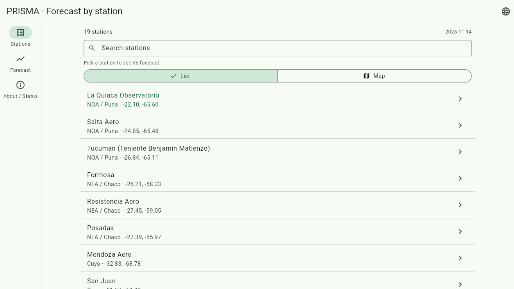
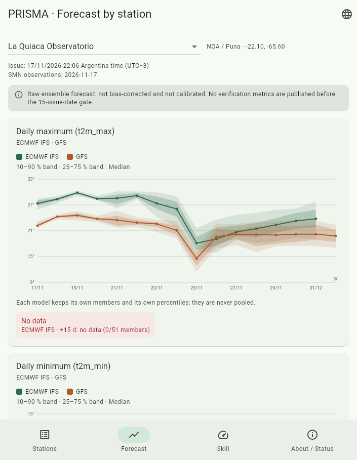
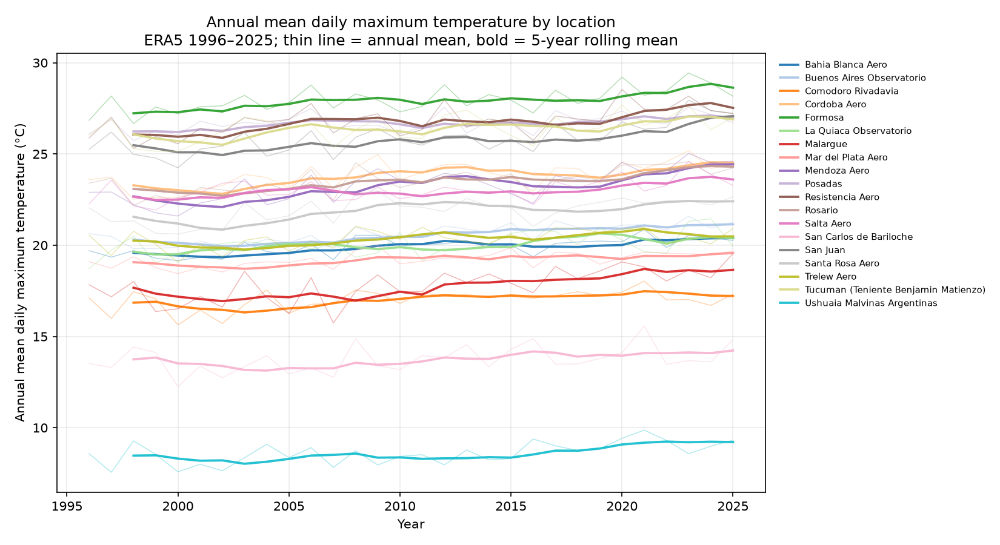
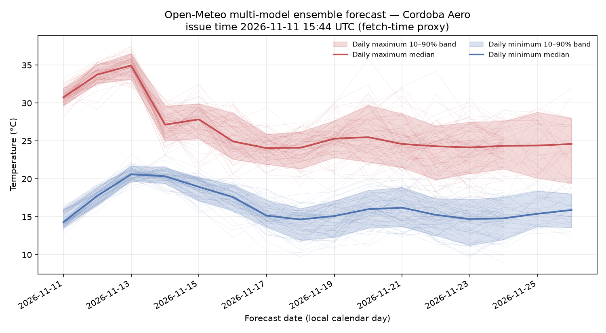
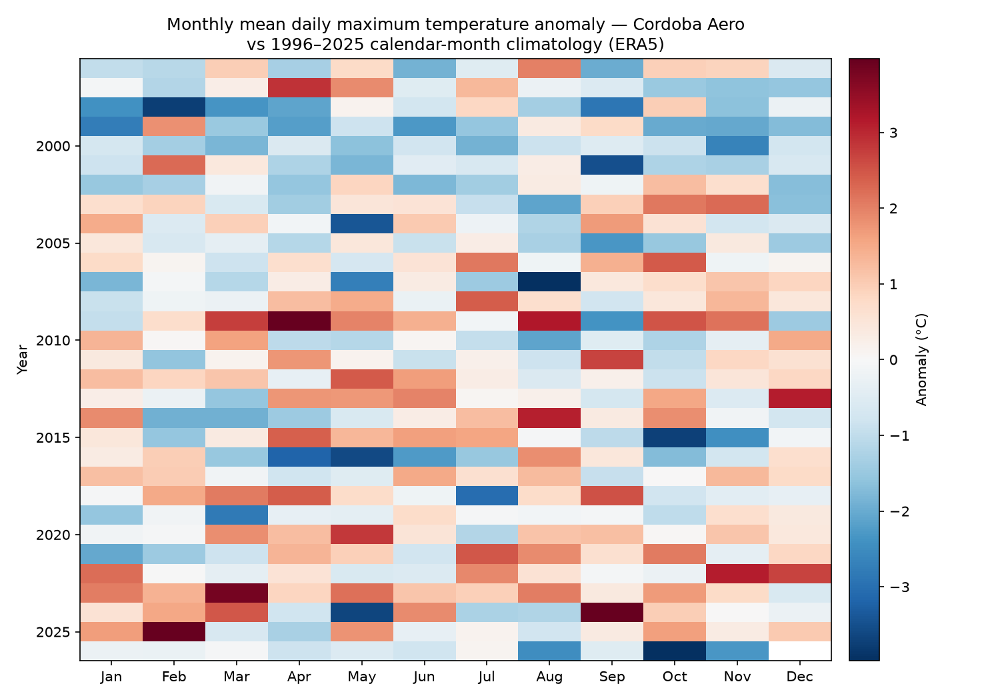

# PRISMA

[](https://doi.org/10.5281/zenodo.24309947)

**Starting with Argentina, designed to scale globally (Empezando por Argentina, diseñado para escalar globalmente).**





Live app: https://akunimal.github.io/prisma-climate/ · Dataset: https://huggingface.co/datasets/Akunimal/prisma-climate

PRISMA is an open, cross-platform project that cross-references real-time weather and climate data, verifies forecasts against observations, and will show calibrated probabilities instead of single numbers.

## Probabilistic Verification & Benchmark Results

PRISMA prioritises empirical verification against established climatology and persistence baselines over unverified model outputs.

### Phase 2 Hindcast Calibration Benchmarks (Frozen Gate)

Evaluated across the 19 meteorological stations in Argentina against NOAA GEFS reforecasts (lead day 1, rolling 45-day window, anti-leakage rule, published under [`v0.1.0`](https://github.com/Akunimal/prisma-climate/releases/tag/v0.1.0) and [`data/skill.json`](data/skill.json)):

| Calibration Method | Target | Horizon | Test Stations | Mean CRPSS vs Raw | Skill Gain vs Raw | Stations Improved | Statistical Significance |
|---|---|---|---|---|---|---|---|
| **Raw GEFS Ensemble** | $T_{max}$ | Lead 1d | 19 stations | 0.0000 | Baseline | — | — |
| **Quantile Mapping (QM)** | $T_{max}$ | Lead 1d | 19 stations | **+0.0943** | **+9.4%** | 9 / 19 (47.4%) | 95% Bootstrap CI > 0 |
| **EMOS (Ensemble MOS)** | $T_{max}$ | Lead 1d | 19 stations | **+0.2187** | **+21.9%** | **12 / 19 (63.2%)** | **95% Bootstrap CI > 0 (PASS)** |

*Representative Station Results ($T_{max}$ Continuous Ranked Probability Score):*
- **La Quiaca:** Raw CRPS: 2.18 °C $\rightarrow$ EMOS: 1.47 °C (**CRPSS: +0.323**), QM: 0.62 °C (**CRPSS: +0.714**).
- **Salta:** Raw CRPS: 1.82 °C $\rightarrow$ EMOS: 1.32 °C (**CRPSS: +0.274**), QM: 1.66 °C (**CRPSS: +0.086**).
- **Tucumán:** Raw CRPS: 2.05 °C $\rightarrow$ EMOS: 1.39 °C (**CRPSS: +0.322**), QM: 1.45 °C (**CRPSS: +0.293**).

### Operational Verification Gate Contract (docs/EVALUATION_PROTOCOL.md)

In strict adherence to the frozen scientific protocol, operational verification metrics are published only after accumulating at least 15 distinct archived forecast issue dates:

> **Current Gate Status:** **14 of 15** distinct issue dates archived under `forecasts/` on Hugging Face (**1 date remaining** until automated gate unlock in ~12–16h).

When the 15th issue date is archived, the automated verification pipeline pre-wired in `scripts/export_site_data.py` (commit `f2ac65b`) will execute `prisma.verify.cli` during static export, computing and publishing:
- **Continuous Ranked Probability Score (CRPS)** for raw multi-model ensemble forecasts (`gfs_seamless`, `ecmwf_ifs025`) across all lead days (1–16).
- **Continuous Ranked Probability Skill Score (CRPSS)** evaluated strictly against two competitive baselines:
  1. **Climatology Baseline:** 30-year station-day reference climatology.
  2. **Persistence Baseline:** Last completed local-calendar observation before forecast issue time.
- **Brier Score & Reliability Diagrams** for probabilistic exceedance thresholds (e.g. precipitation $\ge 1\text{ mm}$, $\ge 10\text{ mm}$).
- **Spread-Error / Spread-Skill Ratio** to evaluate ensemble under/over-dispersion.

## Status

Early-stage independent research. Be precise about what exists today:

Current gate status: 14 of 15 distinct issue dates archived (1 remaining until Day 15 gate unlock); no operational verification numbers published prior to gate opening per docs/EVALUATION_PROTOCOL.md.

**Works today:**

- Ingest of Open-Meteo (ERA5 history + multi-model ensemble forecast), NOAA GHCN-Daily station observations, NOAA ONI/SAM indices, and SMN Argentina daily min/max temperature into normalized Parquet.
- A quality-control pass (physical limits, spikes, duplicate rows) and a source registry with licenses in [`configs/sources.yaml`](configs/sources.yaml).
- Notebook 01 generating real figures for 19 stations across Argentina's climate zones.
- A source-discrepancy report (ERA5 vs GHCN-Daily per station and day, with bias/correlation flags) written to `results/discrepancies/` by script, plus an SMN leg comparing the gitignored regtemp capture against both sources — with overlapping days **only on the ERA5 side** (2025-11-11 → 2026-11-05); the SMN-vs-GHCN comparison has **zero overlapping days** (GHCN-Daily ok rows end 2025-08-24, the regtemp capture starts 2025-11-11) and therefore produces no rows (same flag scheme; gaps reported, never filled). The 2026-11-13 correction in that report shows the ERA5 cold divergence is **leg-dependent** — −2.91 °C against GHCN vs −0.97 °C against SMN on `t2m_max`, over 0 shared days — and the source-flag audit ties the excess against GHCN to **GSOD-derived TMAX values**: −1.38 °C mean bias on G-flag vs −3.45 °C on S-flag (each flag stable across periods), GHCN TMAX 100% S-flag from 2005, the 2004–2005 step coinciding with that G→S switch — an **association; the mechanism is not established**.
- An SMN observation archive workflow ([`.github/workflows/observations.yml`](.github/workflows/observations.yml)) that captures the open-data payloads exactly as served into Hugging Face; its first run succeeded on 2026-11-13 ([run 43484816198](https://github.com/Akunimal/prisma-climate/actions/runs/43484816198)), so `observations/smn/{datohorario,observaciones,regtemp}/2026-11-12/` is archived. The earlier `regtemp` snapshot of `2026-11-10` — the input of the frozen 2026-11-13 climatology adjustment table — is published too, on 2026-11-14, from its GitHub Release by `.github/workflows/hf-backfill.yml`.
- A GitHub Actions workflow that archives the ensemble forecast on a daily schedule (past member values are retained by the provider for about 3 days, but the past run's issue-dated lead structure is not reconstructible — a 2026-11-13 probe showed `past_days` returns the current run's future segment unchanged and past-day cells that do not match the archived issue-dated forecasts, with no run/cycle id in the payload — so a missed day **cannot** be repaired into verification data and is lost; no deep uniform-cycle ensemble backfill exists). The archive mechanism and the schedule trigger are both proven — see [Daily forecast archive](#daily-forecast-archive).
- Verification metrics (`backend/src/prisma/verify/metrics.py`) implemented as code and tests; no numbers published until the 15-issue-date gate in [`docs/EVALUATION_PROTOCOL.md`](docs/EVALUATION_PROTOCOL.md).
- A Flutter web app in [`app/`](app/) that reads the same static export read-only: four screens (Stations, Forecast, Skill, About / Status), a List/Map toggle on the Stations screen with an OpenStreetMap tile map of 140 representative stations across all continents coloured by climate zone, place search over a committed GeoNames gazetteer (14,888 places) that shows each place's nearest station, the distance and a >100 km warning, a "Use my location" button that reads the browser position only on press and never stores or sends it, a probabilistic forecast with per-model quantile bands and a source comparator that keeps models side by side (never pooled), a Skill screen that shows only hindcast-labelled calibration scores with the operational gate closed until 15 issue dates, and a language picker for 10 locales (en, es, pt, fr, de, it, ru, zh, ja, hi) with browser auto-detection and persistence, English as the template and fallback, dates and numbers formatted per locale (Argentina time stays UTC−3), and a machine-translation notice in About and [`docs/APP_GLOSSARY.md`](docs/APP_GLOSSARY.md). `flutter analyze` and `flutter test` run in CI; pushes touching `app/**` redeploy the site.
- FastAPI code in [`backend/src/prisma/api/`](backend/src/prisma/api/) with `/forecast`, `/skill`, `/sources` and `/enso` (9 endpoint tests; run locally with `uv run --project backend uvicorn prisma.api.app:app`; `/skill` serves the same hindcast-labelled document as `data/skill.json`). **No server is offered in Phase 2** (owner decision, 2026-11-15): the app reads the static export, not this API.
- Calibration modules (EMOS and quantile mapping) with unit tests under [`backend/src/prisma/calibrate/`](backend/src/prisma/calibrate/). The full hindcast CRPSS evaluation (Run B, rolling-45 window, anti-leakage rule) passed the Phase 2 exit gate: 12 of 19 stations improved (63.2% $\ge$ 60% threshold, 7-day block bootstrap 95% CI > 0; EMOS cell mean CRPSS: +0.2187, QM: +0.0943), formally approved and released under [`v0.1.0`](https://github.com/Akunimal/prisma-climate/releases/tag/v0.1.0).
- Regional configuration files (`configs/regions/`) covering representative aerodrome stations across 8 regions with ICAO identifiers, local IANA timezones, and diverse Köppen-Geiger zones, staged under evaluation (see [Global expansion status](#global-expansion-status)).

**Does not exist yet:** published operational leaderboard numbers (awaiting the $\ge 15$ issue dates gate), SMN precipitation (no field in the open-data payloads; see [`docs/DATA_SOURCES.md`](docs/DATA_SOURCES.md)), an API server (none is offered this phase — see above), an Android build, and a published skill document: the live Skill screen shows "not available" until hindcast results are committed to Pages and the operational gate opens. Nothing in `results/` was produced by anything other than a script in this repository.

## Global expansion status

PRISMA is designed to scale from Argentina to global coverage under the same verification-before-connector and station-vetting rules (§3.8 of the plan). As of 2026-11-24, the active global network across 8 regions encompasses **132 stations**:

| Region | Config file | Stations (vetted / initial) | Observation Source | Status |
|---|---|---|---|---|
| **Argentina** | [`configs/regions/argentina.yaml`](configs/regions/argentina.yaml) | 19 / 19 | SMN / `ghcn-daily` | `active` |
| **South America** | [`configs/regions/south_america.yaml`](configs/regions/south_america.yaml) | 17 / 17 | `metar-south-america` | `active` |
| **North America** | [`configs/regions/north_america.yaml`](configs/regions/north_america.yaml) | 18 / 18 | `metar-north-america` | `active` |
| **Europe** | [`configs/regions/europe.yaml`](configs/regions/europe.yaml) | 18 / 18 | `metar-europe` | `active` |
| **Asia** | [`configs/regions/asia.yaml`](configs/regions/asia.yaml) | 18 / 18 (1 pruned: UTTT) | `metar-asia` | `active` |
| **Africa** | [`configs/regions/africa.yaml`](configs/regions/africa.yaml) | 14 / 14 (3 pruned: FZAA, HSSS, GOBD) | `metar-africa` | `active` |
| **Oceania & Pacific** | [`configs/regions/oceania.yaml`](configs/regions/oceania.yaml) | 16 / 16 | `metar-oceania` | `active` |
| **Middle East** | [`configs/regions/middle_east.yaml`](configs/regions/middle_east.yaml) | 12 / 12 (4 pruned: OKBK, OLBA, OIIE, OISS) | `metar-middle-east` | `active` |
| **Total Global** | **8 regions** | **132 stations** | **SMN + Global METAR Network** | **`active` (100%)** |

**What `active` means and does NOT mean for global regions:**
- **All 8 regions** (`argentina`, `south_america`, `north_america`, `europe`, `asia`, `africa`, `oceania`, `middle_east`) have passed source verification (§3.8) and station vetting, and have been promoted to `status: active` in [`configs/sources.yaml`](configs/sources.yaml).
- **Explicit boundary:** In the 7 non-Argentina regions, `active` means all 113 station coordinates and elevations are catalog-vetted within 5 km against NOAA AWC and NOAA ISD with verified 4-letter ICAO aerodrome identifiers, the METAR connector (`prisma.ingest.metar`) is verified, and automated daily observation archiving is running on Hugging Face (since 2026-11-18). It does **NOT** mean operational forecast verification or hindcast calibration yet. Forecast archive history for these regions is accumulating daily, and historical ERA5 batch ingestion is engineered (`prisma.ingest.era5_batch`) for execution post-Day 15 gate unlock.
- **Live operational verification and hindcast calibration scores currently apply to the 19 Argentina stations**, with global evaluation unlocking progressively as METAR archives mature.

Full machine-verifiable evidence and methodology:
- Global Verification Plan: [`docs/design/GLOBAL_VERIFICATION_PLAN.md`](docs/design/GLOBAL_VERIFICATION_PLAN.md)
- Per-region station vetting reports: [`results/stations/south_america_vetting.md`](results/stations/south_america_vetting.md), [`results/stations/north_america_vetting.md`](results/stations/north_america_vetting.md), [`results/stations/europe_vetting.md`](results/stations/europe_vetting.md), [`results/stations/asia_vetting.md`](results/stations/asia_vetting.md), [`results/stations/africa_vetting.md`](results/stations/africa_vetting.md), [`results/stations/oceania_vetting.md`](results/stations/oceania_vetting.md), [`results/stations/middle_east_vetting.md`](results/stations/middle_east_vetting.md).
- Raw committed audit JSONs: `results/stations/_evidence/<region>/audit.json`.

## Quickstart

Requires [uv](https://docs.astral.sh/uv/). From the repository root:

```bash
uv sync --project backend
uv run --project backend python -m prisma.ingest
uv run --project backend python scripts/run_notebook.py
```

The third command writes the figures below to `results/figures/`. Run `uv run --project backend pytest` to check the test suite.

## Figures

Annual mean daily maximum temperature per location, ERA5 1996–2025 (5-year rolling mean in bold):



Current ensemble forecast with the 10–90% band for Córdoba:



Monthly temperature-maximum anomaly for Córdoba against its 1996–2025 calendar-month climatology:



All three figures are regenerated by `scripts/run_notebook.py` from the Parquet files under `data/raw/` (downloaded, gitignored).

## Data sources

Every source is registered in [`configs/sources.yaml`](configs/sources.yaml) and described in [`docs/DATA_SOURCES.md`](docs/DATA_SOURCES.md) with license, update frequency, redistribution rights, and day convention. Summary:

| Source | License | Redistributable | Status |
|---|---|---|---|
| Open-Meteo (ERA5 + ensemble) | CC BY 4.0 (free tier non-commercial); ERA5 under Copernicus licence | Derived only | active |
| NOAA GHCN-Daily | Public domain (NOAA/NCEI) | Yes | active, but **stale at source**: last valid rows 2025-08-24 (~50% daily coverage since 2005) |
| NOAA ONI / SAM indices | Public domain (NOAA/NWS) | Yes | active |
| SMN Argentina | CC BY 2.5 AR (PAD_legales.pdf, Infoleg disp25.pdf) | Yes | active — **current station reference for Argentina** |
| NOAA Aviation Weather / MADIS METAR | Public domain (NOAA); non-US aerodromes under WMO Res 40 | Derived only | active (7 global regions, 113 vetted aerodromes; 132 stations total) — see [Global expansion status](#global-expansion-status) |
| Map tiles (OpenStreetMap) | © OpenStreetMap contributors | Yes | non-data dependency; loaded directly by the app from OpenStreetMap servers |
| Place names (GeoNames) | CC BY 4.0 | Yes | committed gazetteer `data/places/ar.json`, built by `scripts/build_places.py`; loaded by the app only when a place search starts |

## Daily forecast archive

The workflow [`.github/workflows/ingest.yml`](.github/workflows/ingest.yml) is scheduled for **06:47, 09:47, 12:17, 14:43 and 18:31 UTC** on `ubuntu-latest`, fetches the Open-Meteo ensemble for all configured locations with its `issue_time`, and stores the Parquet outside git:

1. **Primary — Hugging Face dataset [`Akunimal/prisma-climate`](https://huggingface.co/datasets/Akunimal/prisma-climate):** one file per issue date at `forecasts/<issue_date>/openmeteo-ensemble_<issue_date>.parquet` (secret `HF_TOKEN`, variable `HF_DATASET_REPO`). The issue date is read from the parquet's `issue_time`, never from the runner clock; an existing target is skipped, so the first archive of an issue date is canonical and frozen.
2. **Fallback / provenance — GitHub Release `forecast-YYYY-MM-DD`:** used when `HF_TOKEN`/`HF_DATASET_REPO` are unconfigured **or** the Hugging Face upload step fails, so a transient HF error never loses a day. Releases are kept afterwards (for example [`forecast-2026-11-11`](https://github.com/Akunimal/prisma-climate/releases/tag/forecast-2026-11-11)).

**Schedule forensics lives in [`docs/OPERATIONS.md`](docs/OPERATIONS.md):** observed run history (the first `event=schedule` run completed 2026-11-12, hours late; the 2026-11-12 issue date was rescued by a manual `workflow_dispatch`), the slot-to-run readings, and the residual-risk note on GitHub's best-effort schedule.

Schema, licences, attribution, provenance and the 15-issue-date evaluation gate are documented in [`docs/HF_DATASET_CARD.md`](docs/HF_DATASET_CARD.md), mirrored to the dataset's `README.md` (the mirror is republished by dispatching `hf-backfill.yml`; last republished 2026-11-14 — [run 43583728905](https://github.com/Akunimal/prisma-climate/actions/runs/43583728905), dataset revision `0b4589e8fa230733b363bb36c2988be95fbcc911`). The gate counts distinct issue dates regardless of trigger; the manual rescue is recorded in the card and in [`docs/DATA_SOURCES.md`](docs/DATA_SOURCES.md) so it stays visible.

## Observation archive (SMN)

[`.github/workflows/observations.yml`](.github/workflows/observations.yml) captures the SMN Argentina open-data payloads exactly as served into the same dataset under `observations/smn/<dato>/<date>/`: `datohorario` and `observaciones` daily at 07:17, 11:41 and 19:09 UTC, `regtemp` weekly on Mondays at 04:34 UTC, `workflow_dispatch` enabled. It is isolated from `ingest.yml` (own schedule, own concurrency group, `contents: read`, no push step, so it never commits to `main` — its run status travels in the `github_run` block of the manifest it writes, and an SMN failure fails only this workflow). The date key comes from the payload's `FECHA` and never from the runner clock (`regtemp` uses the last `FECHA` of its rolling 365-day window), an existing target is skipped so the first capture of a date is canonical, and because these endpoints ignore `fecha` (probed 2026-11-13) a missed day cannot be backfilled; the payloads are CC BY 2.5 AR with attribution to the SMN, distinct from the dataset-level cc-by-4.0 tag that covers `forecasts/`. The one exception to "no backfill" is the locally captured `2026-11-10` regtemp snapshot — the frozen climatology adjustment table's input — published on 2026-11-14 from its GitHub Release [`observations-regtemp-2026-11-10`](https://github.com/Akunimal/prisma-climate/releases/tag/observations-regtemp-2026-11-10) by the observations leg of `.github/workflows/hf-backfill.yml`: one commit, both sha256 values re-checked, manifest regenerated by script, target skipped if present.

Raw or archived data is never committed; GitHub Actions artifacts are not used as storage. Each run commits only [`results/ingest_status.json`](results/ingest_status.json) — last run, rows per source, failures — so scheduled workflows stay enabled.

## Repository layout

```
configs/     region stations (configs/regions/) and the source registry
data/places/ committed GeoNames gazetteer for the app (the rest of data/ is gitignored)
backend/     Python package: ingest connectors, QC (uv, ruff, pytest)
notebooks/   analysis notebooks
scripts/     runnable helpers (notebook execution, forecast upload)
site/        plain HTML page (site/index.html) published at /basic/
results/     only outputs generated by repository scripts
docs/        plan, architecture, data sources, evaluation protocol, roadmap, images
app/         Flutter web app: 10 locales, station map, place search + GPS, reads the static export (docs/APP_GLOSSARY.md)
```

Adding a data source means one new connector under `backend/src/prisma/ingest/` plus one entry in `configs/sources.yaml` — nothing else. Adding a country means one new file under `configs/regions/`.

## Cite this work

[](https://doi.org/10.5281/zenodo.24309947)

If you use PRISMA Climate in your research, forecasts, or software, please cite it using [`CITATION.cff`](CITATION.cff):

- **Release:** `v0.1.0 — frozen evaluation protocol`
- **DOI (v0.1.0):** [10.5281/zenodo.24309947](https://doi.org/10.5281/zenodo.24309947)
- **Concept DOI (all versions):** [10.5281/zenodo.24309946](https://doi.org/10.5281/zenodo.24309946)
- **Evaluation Protocol:** [`docs/EVALUATION_PROTOCOL.md`](docs/EVALUATION_PROTOCOL.md)
- **AI Use Disclosure:** [`docs/AI_USE.md`](docs/AI_USE.md)

## Development

PRISMA Climate is developed under direct human leadership with the assistance of AI coding agents. Roles, verification practices, and scientific reproducibility standards are documented in [`docs/AI_USE.md`](docs/AI_USE.md).

Architecture and operational guidelines:
- Architecture: [`docs/ARCHITECTURE.md`](docs/ARCHITECTURE.md)
- Evaluation Protocol: [`docs/EVALUATION_PROTOCOL.md`](docs/EVALUATION_PROTOCOL.md)
- Operations and Forensics: [`docs/OPERATIONS.md`](docs/OPERATIONS.md)
- Roadmap: [`docs/ROADMAP.md`](docs/ROADMAP.md)
- Project Plan (Spanish): [`docs/PLAN.md`](docs/PLAN.md)

## License

Apache-2.0, see [`LICENSE`](LICENSE).
